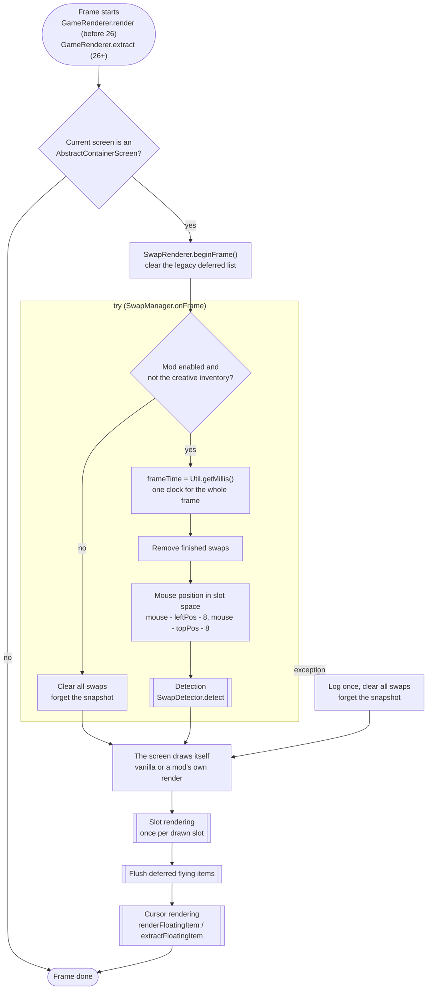

# Smooth Swapping – how it works

Program flow from the start of a frame to the drawn item.
Boxes with double side lines are subroutines with their own chart below.

## Main flow (once per frame)

Notes:

- Detection runs **before** anything is drawn, so every hook in this frame sees the same swaps and the same `frameTime`.
- Detection starts from `GameRenderer`, not from the screen, so it also runs for screens that override `render` without calling `super` (e.g. Sophisticated).
- When the mod is disabled or an error was caught, there are no swaps. The screen still draws, and every hook just calls the original.
- The `try` only covers the steps inside the box. Exceptions while drawing are not caught there.
- The order slots → flush → cursor is what keeps flying items above every slot but below the carried item.
